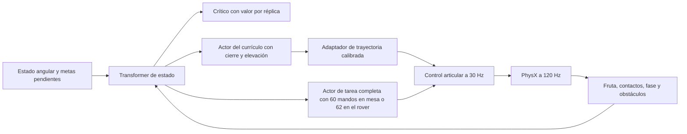
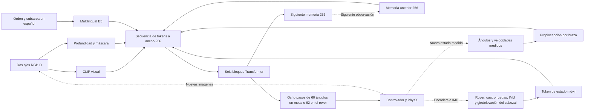

# Arquitectura

## Agricultura bimanual

### Teacher PPO

El actor y el crítico reciben 382 valores en el torso fijo. En el rover reciben 398, incluidos los 12 sensores móviles, las dos últimas consignas del cabezal y la alineación de cada ojo con la fruta. Cada red tiene tres bloques Transformer de 128 canales y cuatro cabezas. El teacher móvil controla las 60 juntas de brazos y manos y los dos ejes de mirada. Los contactos y la altura medida determinan el éxito físico.

### Estudiante VLA

| Modelo | Entradas | Salidas |
| --- | --- | --- |
| Visión RGB | Dos imágenes de 224 × 224. | CLIP visual congelado. 100 tokens de 512 en total. |
| Profundidad | Dos mapas en metros con máscara de validez. | 98 tokens con distancia y proporción válida. |
| Lenguaje | Orden global y subtarea activa en español. | Multilingual E5 congelado. Un token de 384. |
| Propiocepción | `q[60]` y `dq[60]`. | Dos tokens de 60, uno por brazo. |
| Rover de surco | Cuatro velocidades de rueda, seis canales de IMU y dos ángulos medidos del cabezal. | Un token adicional de 256 canales para el perfil móvil. |
| Memoria | Estado anterior de 256 valores. | Un token de contexto. Se reinicia al comienzo del episodio. |
| Fusión | 202 tokens de contexto y 16 consultas de acción en mesa. En el rover v3 son 203 y 24, con una consulta del cabezal por paso. Ambos perfiles tienen una consulta de memoria. | Seis bloques Transformer con 256 canales y ocho cabezas. |
| Salida | Consultas procesadas. | Ocho pasos de 60 ángulos en mesa o 62 en el rover, en radianes, y memoria actualizada de 256 valores. |

Los tokens de las modalidades se proyectan a 256 canales y se concatenan en el eje de secuencia. El orden de las cámaras y los brazos es izquierda, derecha. El controlador aplica los límites articulares y permite volver a observar antes de ejecutar el resto del bloque. [Referencias de aprendizaje](referencias-aprendizaje.md)

## Patrón de software

Usamos **arquitectura hexagonal**, también llamada puertos y adaptadores. La regla queda en `AGENTS.md`. [Artículo original de Alistair Cockburn](https://alistair.cockburn.us/hexagonal-architecture)

| Pieza | Responsabilidad |
| --- | --- |
| Núcleo | Define tareas, fases, éxito físico, unidades y límites. |
| Puertos | Especifican observaciones, acciones, etiquetas, memoria y episodios. |
| Adaptadores de entrada | Los comandos de entrenamiento y evaluación seleccionan escenario, algoritmo y perfil. |
| Adaptadores de salida | Isaac Sim aplica comandos y entrega sensores. HDF5 guarda episodios. FFmpeg genera videos. CLIP y E5 producen tokens. |
| Comprobación | Contratos con datos sintéticos y ejecución en PhysX para verificar contacto y movimiento. |

En el teacher, `task_rules.py` aplica la recompensa y las transiciones a tensores. `environment.py` conecta esas reglas con los sensores y el controlador de Isaac Lab. En el estudiante, `bimanual_contract.py` comprueba el formato y el adaptador de percepción conecta CLIP y E5 al Transformer. Las entradas CLI componen estas piezas.

## Elevación de un brazo

El teacher Transformer recibe 95 valores de estado y produce 26 mandos con sinergias de dedos. El VLA v5 usa dos RGB, texto, 30 posiciones, 30 velocidades y memoria. Devuelve ocho pasos de 30 ángulos y una memoria de 256 valores. La profundidad se graba para inspección.

El éxito exige levantar el objeto 15 cm y sostenerlo 0,5 s con contactos opuestos. Los checkpoints guardan su contrato de escena y control. Reanudar recupera pesos y optimizador. Las ejecuciones bimanuales requieren su propio checkpoint. [Flujo de elevación](mvp.md)
